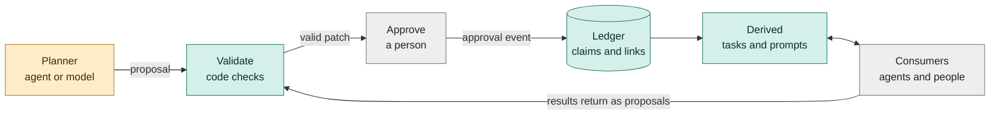

# Jarvistark: concept, architecture and repository structure

> **Status:** draft v0.1, 12 October 2026. A proposed direction, not implemented software.
>
> **Relationship to the Master Specification.** This document reviews `Jarvistark_Master_Specification.md` (the original blueprint) and proposes a tighter architecture and repository layout. Where the two differ, this document is the proposal and the specification remains the record of the original blueprint. References such as §11 point into the specification.

## Contents

1. [Concept](#1-concept)
2. [Architecture](#2-architecture)
3. [Review of the Master Specification](#3-review-of-the-master-specification)
4. [Repository structure](#4-repository-structure)
5. [Build order](#5-build-order)
6. [Open decisions](#6-open-decisions)
7. [Appendix A: illustrative shapes](#appendix-a-illustrative-shapes)
8. [Appendix B: glossary](#appendix-b-glossary)
9. [Sources](#sources)

---

## 1. Concept

### 1.1 What Jarvistark is

Jarvistark takes a rough software idea, described in ordinary language, and turns it into a plan that a coding agent can build from: explicit requirements, an application breakdown, architecture, environment prerequisites, an ordered task graph with acceptance criteria, and a prompt for each task. It works alongside the coding tools and models people already use. It is not a new foundation model, a chatbot, or an autonomous code generator (§1, §3).

The sharpest description is a **system of record for intent**. Planning is the front end, and prompts are one rendering of the record rather than the product. The specification says the same thing in its closing paragraph: the differentiator "is not generating longer prompts", but "maintaining a traceable, validated representation of what the user intends to build and using that representation to guide implementation without silently changing the assignment" (§24).

### 1.2 The problem

A coding agent given an underspecified idea tends to drift. It invents requirements or expands scope without approval, skips consequential questions, produces one large tangled implementation, picks unsuitable dependencies, omits error states and permissions, assumes tools are installed, and claims success without running checks (§2.1). Rough descriptions leave out requirements, constraints, setup steps and testable definitions of success.

Jarvistark addresses this by keeping an explicit, versioned specification and deriving every downstream instruction from it.

### 1.3 The core idea

- **Claims, not documents.** Every requirement, assumption, decision and question is a *claim* with an origin and an acceptance state. The Markdown documents in §10 are views of that ledger.
- **Models propose, people accept, code verifies.** A model never writes to the specification. It submits a typed proposal that validators check and a person accepts. After acceptance, task ordering, context selection and prompt rendering are deterministic and testable.
- **Readiness, not volume.** Success means "ready to hand to an agent": no blocking questions, every must-have has a check, every task has accepted inputs. The number of documents generated is not the measure.

### 1.4 Principles

The specification's principles (§2.3) stand: preserve intent (the original input stays immutable), separate facts from assumptions, structure before implementation, provider independence, project-language independence, evidence-aware technical guidance, practical outputs, human control and honest verification.

The addition here is that each principle should be a property of the system, enforced by a mechanism (section 2.3), and not an instruction to a model.

### 1.5 What it is not

Jarvistark is not a foundation model, a chatbot without persistent structured state, a token compressor, a code simplifier, a universal IDE session interceptor, or a guarantee of bug-free software. In its first release it is not an all-in-one autonomous software builder (§3). How far orchestration goes beyond that is open (decision D2).

### 1.6 Who it is for, and what v1 covers

The specification lists beginners, students, solo developers, founders and product teams, AI-first developers and engineering teams (§4). The v1 scoped in earlier design work is narrower. The decisions below are carried over and should be confirmed; the shape in particular is open (decision D1).

| Area | v1 decision |
|---|---|
| First user | A non-technical founder with a rough app idea |
| Output | An app-building guide: ordered steps and tailored prompts for coding agents (Claude Code, Codex and similar), sequenced into builder-sized prompts that do not break each other |
| After delivery | The full plan up front, plus a repair path when a step breaks |
| First app class | Apps with accounts and a database (SaaS, dashboards, trackers). In scope: email and Google/social login, file and image uploads. Declined: payments, multiple user roles, third-party API integrations, real-time features and notifications |
| Intake | A guided form: what is tracked, who sees what, key actions |
| Shape | A plugin or skill pack inside the coding agent. The agent runs the interview and writes the files; no server |
| Execution | An orchestrator runs each build step in its own subagent with clean context, pausing for the founder at milestones (auth, data model, each core feature, final) and on any failure |
| Assumed setup | The coding agent and a repo already exist. Prerequisites are listed clearly; there is no beginner setup guide in v1 |
| Headline success measure | The share of founders who reach a finished, working app |

The specification's worked example is a college attendance app with teachers, class teachers, administrators and automatic parent notifications (§4). It needs multiple roles and notifications, which v1 declines. It is kept as a negative test: the accounts-and-database profile should decline it explicitly (mechanism 4).

### 1.7 Measuring success

§18.2 lists thirteen metrics that measure the plan (coverage, consistency, traceability), setup and export reliability, and rework from planning mistakes. None measures whether a user ends up with a working app. The headline measure above does, and it is the only one that tests whether any of this helps.

Before building the engine, hand-run the pipeline on three to five real ideas and track it (section 5, step 2).

---

## 2. Architecture

### 2.1 Overview



Text version: Planner, then Validate, then Approve, then Ledger, then Derived, which Consumers pull from and report back to. Results return to Validate as proposals.

Whoever plays the planner, every change crosses validation and a person's approval before it reaches the ledger. Everything downstream is derived from the ledger, and results come back as proposals rather than edits. Ports underneath (storage, project scan, shell runner, model access) keep the core from touching the outside world directly.

| Element | Role | Trust |
|---|---|---|
| Planner | Proposes claims and revisions; a host agent or a model adapter | Untrusted: its output is a proposal |
| Validate | Schema, ID, reference and rule checks; returns machine-readable errors | Deterministic code |
| Approve | A person accepts, rejects or edits; recorded as an event | A person |
| Ledger | Append-only record of claims, links and approvals | Deterministic code |
| Derived | Documents, task graph, context bundles and prompts | Deterministic code |
| Consumers | Coding agents and people who pull tasks and report results | Outside world |
| Ports | Interfaces for storage, scan, runner and model; adapters live outside the core | Outside world |

### 2.2 The planner is a role, not a component

The planner is whoever proposes changes to the ledger. In a skill-pack or MCP shape, the host agent plays it: it runs the interview and submits proposals, so Jarvistark never has to call a model. In a standalone shape (a CLI with its own key, a web app), a model adapter plays it. Both emit the same typed proposal. Most of §7.3 (provider adapters, structured-output handling) and the provider-key and data-egress rules in §15 are therefore needed only for the second shape.

Protocol direction supports this:

- **Sampling is deprecated.** Sampling, the MCP feature that lets a server borrow the host's model, is deprecated as of the 2026-07-28 protocol revision (SEP-2577). The TypeScript SDK documentation tells server authors to call their model provider's API directly instead. "Borrow the host's model through MCP" is not something to design around.
- **Elicitation survives.** A tool handler returns an `input_required` result with its questions, the client answers, and the call is retried. This works over stateless per-request connections with no session ID. Clarifying questions and approvals can go through the host, but durable state has to live in Jarvistark's own store.
- **Anything echoed back through the client is untrusted.** That includes the SDK's `requestState` and the `inputResponses` a handler receives. The SDK documents integrity-protecting `requestState` (HMAC or AEAD, bound to the principal and an expiry) and validating responses against a schema.
- **The specification's SDK link is current.** The link in §23 points at a line that is still right: v2 is the stable SDK line implementing the 2026-07-28 revision.

### 2.3 Six mechanisms the specification leaves implicit

**1. Claims with three axes.** §5.2's six classes blend *origin* (user-stated, inferred, observed in the repository) with *kind* (recommendation, assumption, question). Acceptance is handled unevenly: the §9.2 example carries `status: approved`, while Stage 4 uses proposed, accepted, rejected and superseded, and only for assumptions. §9.1 then splits Requirement, Assumption, OpenQuestion and ArchitectureDecision into separate entity types, each free to grow its own vocabulary.

Use one claim type with three fields: kind (requirement, constraint, assumption, question, decision), origin (user-stated, inferred, recommended, observed) and state (proposed, accepted, rejected, superseded). Two rules make it enforceable:

- A user-stated claim must point to a span of the original input: a text range, or a form field when intake is a guided form.
- A claim becomes accepted only through a recorded approval by a person.

If the approver is a founder rather than an engineer, the text they accept should be plain language, with the technical phrasing derived from it and flagged stale if it changes. Prompt compilation reads accepted claims only, with assumptions shown as assumptions.

**2. Proposals, not writes.** A planner returns a typed patch (add, revise, retire, link) using provisional keys. The engine validates it, mints the real IDs (never reused) and appends an event. A bad patch is rejected with machine-readable errors that the planner can repair within a retry budget.

Models never mint IDs and never edit an accepted claim in place. A revision is a new proposed claim that supersedes the old one only when accepted. That makes §21's rule against silently changing approved scope or architecture a property of the system instead of a request to the model. If providers are called directly, send simplified generation schemas, since structured-output modes typically accept only a subset of JSON Schema, and run the full canonical checks afterwards.

**3. A build graph, not a linear pipeline.** The §6 state model is a straight line from INTAKE to EXPORT, with one optional clarification step, no edges back, and no state for Stage 13's feedback. Instead, let every derived artifact record the hashes of the claims it was built from.

- When a claim changes, everything downstream is marked stale. That gives §5.13's change impact for free.
- The scheduler recomputes only what is stale. That gives resumability for free.
- The project's phase becomes a function of artifact states instead of a stored enum.
- Model-backed stages re-run as new proposals and never overwrite accepted output.
- Approval checkpoints go after the specification and after the architecture, so nobody faces fifteen documents at the final review.

**4. Profiles instead of web-app assumptions.** §9.1 puts web vocabulary (Page, UserFlow, Component) into the core entity list, while §2.3 promises independence from the project's language and §5.6 itself says pages and screens apply "for web and mobile applications". Keep the core generic (claim, component, interface, data entity, task, check) and let a profile supply the intake questions, decomposition checklist, environment defaults and validator rules. "Every protected operation has an authorization requirement" only makes sense in profiles with accounts.

A profile also declares its support boundary, so intake can decline an out-of-scope idea explicitly instead of producing a plausible-looking plan. The attendance example then becomes a useful negative test for an accounts-and-database profile. Profiles are mostly data, which makes them the easiest thing for contributors to add and the natural home for reusable templates that improve across projects.

**5. Pull, with evidence.** Exported prompt files remain the portable fallback, but the stronger design is that the agent pulls. It asks for the next ready task and receives only the claims, decisions and interfaces linked to it, chosen by a deterministic graph walk with a size budget rather than by a model's guess. It then reports back with evidence.

Acceptance criteria are structured checks (command, expected result, status). A result can be recorded only with who ran it and what it printed, and self-reported results are labeled as such. That turns §21's rule about never claiming a test passed into a schema rule. An orchestrator that runs a subagent per task and pauses at milestones is just another consumer of the same loop, and agents file change requests as proposals rather than editing the specification.

**6. Enforcement outside the model.** Instructions are advisory; checks are the enforcement. Böckeler's hands-on write-up of Spec Kit and Kiro found that, even with files, templates, prompts, workflows and checklists, the agent frequently did not follow all the instructions. Two consequences follow in agent-hosted shapes:

- The approve step must be something the model cannot do for itself: an MCP elicitation that the host puts in front of the person, or a command the host will not run without the person's permission (so it must not be allow-listed).
- Canonical files are writable only through Jarvistark's own command. `validate` flags out-of-band edits by content hash, and where the host supports hooks or permission rules, direct writes to those files are denied (section 4.5 has the Claude Code specifics).

Keep any generated AGENTS.md short and mostly a pointer, since it is loaded into every session. AGENTS.md is an open standard stewarded by the Linux Foundation's Agentic AI Foundation, with a list of 20-plus supporting coding agents. Claude Code reads CLAUDE.md, and reads AGENTS.md only where there is no CLAUDE.md, so a one-line CLAUDE.md that imports it (`@AGENTS.md`) covers both.

### 2.4 One change, end to end

1. The person describes the idea. The original input is stored unchanged and hashed.
2. The planner reads it and returns a proposal: new claims with provisional keys, each user-stated claim pointing at a span of the input.
3. The engine validates the proposal and returns errors for the planner to repair if needed. It then mints IDs and appends an event.
4. The person reviews the claims in plain language and accepts, rejects or edits them. Acceptance is recorded as an approval event.
5. Derived artifacts that depend on the accepted claims are rebuilt. Anything built from claims that later changed is marked stale.
6. An agent asks for the next ready task. The engine walks the graph to the claims, decisions and interfaces linked to that task, within a size budget, and renders the prompt.
7. The agent does the work and reports each check with its command and output. Results are recorded as evidence and labeled self-reported or runner-verified.
8. If the work shows the specification is wrong, the agent files a change request as a proposal. A revision supersedes the old claim only when accepted, and downstream artifacts are marked stale.

---

## 3. Review of the Master Specification

### 3.1 Verdict

The principles are the right ones: keep the original input immutable, separate what the user said from what was inferred, lean on deterministic validation rather than another model's opinion, never change approved scope silently, and build the deterministic core before any model integration. The specification also already contains the pieces a plan needs: a traceability graph (§9.3), security and privacy requirements (§15), error handling and recovery (§16) and a testing strategy (§18).

What it leaves implicit is the *mechanism* that makes those principles true: how a model's output becomes accepted truth, and how the specification stays honest once code exists. Most of the architecture in section 2 is about that mechanism.

### 3.2 The decision to make first

The specification describes a standalone TypeScript platform: a CLI, an MCP server, a VS Code extension, a web app and provider adapters. The v1 scoped earlier (section 1.6) is smaller and different: a skill pack that runs inside the coding agent, for non-technical founders building apps with accounts and a database, with payments, multiple roles, third-party integrations and real-time features declined.

There is a second consequence. §21 tells any coding agent to treat the document as the source of truth, so an agent building from it today would build the platform. The architecture in section 2 is shell-agnostic, so the choice does not touch the core (decision D1).

### 3.3 Where the proposal departs from the specification

| Specification | What it says | Proposed |
|---|---|---|
| §5.2, §9.1, Stage 4 | Six finding classes; Requirement, Assumption, OpenQuestion and ArchitectureDecision as separate entity types; proposed/accepted/rejected/superseded only for assumptions | One claim type with three axes: kind, origin, state (mechanism 1) |
| §6 | A linear 11-state pipeline from INTAKE to EXPORT with one optional clarification step, no edges back, and no state for Stage 13 feedback | A build graph with input hashes and staleness; phase derived from artifact states (mechanism 3) |
| §9.1 | Page, UserFlow and Component in the core entity list | A generic core plus profiles (mechanism 4) |
| §10 | 15 numbered documents, six prompt files and a JSON file | Views of the ledger, chosen by the profile; prompts rendered when an agent pulls a task (mechanism 5) |
| §7.3, §15 | Provider adapters, key handling and data-egress rules as part of the core stack | Needed only in the standalone shape (section 2.2) |
| §11 | Four apps and eleven packages | A day-one subset: `core` plus profiles (section 4) |
| §21 | Twenty rules mixing invariants and working agreements | Invariants as tests; working agreements in AGENTS.md (finding 7 below) |

### 3.4 Where it sits among spec-driven tools

The specification does not mention existing spec-driven tools, and it should. Spec-driven development is now a crowded category: spec-first frameworks (Spec Kit, OpenSpec, BMAD-METHOD, Task Master AI), a spec-driven IDE (Kiro), and Tessl, which treats the spec as a long-lived artifact.

Böckeler's October 2025 analysis distinguishes three levels:

1. **Spec-first:** a well thought-out spec is written first and used for the task at hand.
2. **Spec-anchored:** the spec is kept after the task and used for evolution and maintenance.
3. **Spec-as-source:** the spec is the main source file over time, and humans edit only the spec.

Jarvistark's ledger is spec-anchored: it outlives each task and drives change impact (§5.13). It does not aim at spec-as-source.

Her critiques are the questions Jarvistark has to answer: workflows that felt like overkill for the size of the problem, piles of Markdown to review ("I'd rather review code than all these markdown files"), and a false sense of control. She also notes that older model-driven development gave authors parseable, tool-supported specifications (custom UML or a textual DSL), which free-text specs give up.

That is the opening: a structured, machine-checked specification, sized to the problem, for a user who is not a developer. Add that positioning to §1. Her write-up predates mid-2026 and these tools move quickly, so check their current state before positioning against them.

### 3.5 Gaps and recommendations

1. **Orchestration is undecided.** The category line and §24 say "coding-agent orchestration", while §19 defers autonomous building and multi-agent orchestration. The v1 execution model, a subagent per build step with pauses at milestones, is orchestration. Choose a level explicitly (decision D2). The three levels are consumers of one ledger, so the choice shapes the shell, not the core.
2. **No outcome metric.** §18.2's thirteen metrics measure the plan, setup and export reliability, and rework from planning mistakes, but none measures whether a user ends up with a working app. Add the headline measure (section 1.7) and hand-run three to five real ideas before building the engine.
3. **Two sources of truth (§7.9, §10).** JSON is canonical, but people and agents will edit the Markdown, and the specification does not say what happens then. Make generated Markdown read-only with a content-hash header and have `validate` flag hand edits. Round-trip import can wait (decision D3).
4. **Questions need a stopping rule (§5.3).** "Avoid an endless questionnaire" is a principle, not a mechanism. Give each open question an impact class and a blocking flag, ask only the blocking ones a few at a time, and batch the rest as assumptions for bulk review. "Ready to implement" then becomes computable.
5. **Hand-curated catalogs will rot (§8.3).** Keep a small rules file of opinionated defaults and known incompatibilities, and query registry metadata at planning time (cached and timestamped). Verify that every package name a model proposes actually exists before showing it; models sometimes invent them.
6. **The MVP is still a product (§19).** It has 15 required items, 21 entity types (§9.1), 11 packages and 4 apps (§11). Define a walking skeleton, and let the default export be a brief plus whatever the profile needs, not all 15 numbered documents in §10.
7. **§21 mixes two things.** Invariants (IDs unique and never reused, task graph acyclic, no secrets in exports, writes confined to the workspace) belong in tests so an agent cannot quietly violate them. Working agreements (plan first, completion report) belong in AGENTS.md.
8. **Intent preservation needs a mechanism (§18).** Add an input-coverage map, where every sentence of the original input maps to at least one claim or is marked non-actionable and the user can see it. Add mutation tests too (inject a contradiction; validators must catch it), and recorded model responses replayed in CI.

---

## 4. Repository structure

### 4.1 Principles

- One public repository named `jarvistark` (§11), organized as a pnpm workspace.
- §11 is the target architecture. It says not to create every package as an empty placeholder and to start with the smallest set that supports a working end-to-end workflow. The layout below is that smallest set.
- The layout works for either shape. The shape decides which `apps/` get built, not the core.
- A folder appears when a second consumer needs it.

### 4.2 Jarvistark's own repository

```text
jarvistark/
├── README.md  LICENSE  ROADMAP.md
├── AGENTS.md                    # short; read by Codex and most agents
├── CLAUDE.md                    # one line: @AGENTS.md
├── package.json  pnpm-workspace.yaml  tsconfig.base.json
├── biome.json  vitest.config.ts
├── .github/
│   ├── workflows/ci.yml         # lint, typecheck, test, fixtures, profiles
│   ├── ISSUE_TEMPLATE/          # bug, feature, profile request
│   └── PULL_REQUEST_TEMPLATE.md
├── docs/
│   ├── architecture.md          # concept + diagram; the source of truth
│   ├── decisions/               # shape, orchestration, canonical format
│   └── spec/                    # the Master Specification, as history
├── packages/
│   └── core/                    # the gate: no file, network or model access
│       ├── src/
│       │   ├── claims/          # kind / origin / state, source spans
│       │   ├── proposals/       # typed patches, provisional keys, repair errors
│       │   ├── ledger/          # append-only events, ID minting, approvals
│       │   ├── validate/        # rules, out-of-band edit detection
│       │   ├── graph/           # artifacts + input hashes, staleness, readiness
│       │   ├── render/          # deterministic docs and prompts
│       │   ├── context/         # graph-walk context under a size budget
│       │   ├── checks/          # structured acceptance checks + evidence
│       │   └── ports/           # interfaces only: storage, scan, runner, model
│       └── test/                # unit, mutation, snapshot, import-boundary
├── profiles/
│   └── accounts-database/       # data only: profile, intake, rules, boundary
└── fixtures/
    ├── ideas/                   # 3–5 real ideas, one that must be declined
    ├── ledgers/                 # hand-run results to diff against
    └── model-responses/         # recorded planner outputs, replayed in CI
```

- **Commit order.** `docs/` and `fixtures/ideas/` go in first (settling the shape and hand-running the pipeline). Then build `core` in this order: claims, proposals, ledger, validate, then graph, render, context, checks.
- **Why the specification moves.** §11 puts a `PRODUCT_SPEC.md` at the root, and §21 tells agents to treat the specification as the product source of truth, so an agent will try to build all of it. Under `docs/spec/`, with `AGENTS.md` pointing at `docs/architecture.md` and `docs/decisions/`, it becomes background.
- **Profiles are the contribution surface.** A new profile is a folder of data, so a contributor never touches TypeScript. CI can validate each profile against core's schema and check that its out-of-scope idea is declined.
- **The core boundary is a test.** `core` importing a file, network or model API fails CI.
- **Left out on purpose.** CONTRIBUTING, SECURITY, CODE_OF_CONDUCT and SUPPORT (§14.3) wait for the public release. Tooling is the §7 set: pnpm workspaces, Biome, Vitest and Zod.

### 4.3 Where §11's folders went

| Specification §11 | Here |
|---|---|
| `core`, `schemas`, `validator`, `pipeline`, `prompt-compiler`, `exporters` | One package, `core`, as modules: claims and proposals, validate, graph, render and context |
| `storage`, `repository-analyzer` | `ports/` in `core`, implemented later in `packages/adapters-node` |
| `llm` | `packages/model-adapters`, standalone shape only |
| `architecture-planner`, `environment-catalog`, `catalogs/`, `templates/` | `profiles/` data: decomposition checklist, environment defaults, rules |
| `PRODUCT_SPEC.md`, `tests/`, `examples/` | `docs/spec/`, per-package `test/`, and `fixtures/` |
| `apps/*` | Unchanged, but they appear one at a time (section 4.4) |

### 4.4 What appears later, and when

- **`apps/cli`** is the first shell: `init`, `propose`, `approve`, `validate`, `next`, `done` and `export`, each a thin call into `core`.
- **`apps/plugin`** is the skill pack for a host agent. It holds `.claude-plugin/plugin.json` (only `name` is required), `skills/jarvistark/SKILL.md` for the interview protocol, and `hooks/hooks.json` for a guard on ledger writes. To install it straight from this repository, add `.claude-plugin/marketplace.json` at the root with `"source": "./apps/plugin"`. Relative plugin sources must start with `./`.
- **`packages/adapters-node`** holds real storage, project scan and shell runner behind the ports. It arrives once `core` first needs real I/O.
- **Last, or only if needed:** `apps/mcp-server` after the CLI works, `packages/model-adapters` for the standalone shape, then `apps/vscode-extension` and `apps/web`.

### 4.5 What Jarvistark writes into a user's repository

```text
their-app/
├── AGENTS.md                    # generated, short: the loop + where truth lives
├── CLAUDE.md                    # one line: @AGENTS.md
├── .claude/settings.json        # optional: deny Edit on .jarvistark/ledger/**
├── .github/workflows/jarvistark.yml   # `jarvistark validate` on every pull request
├── .jarvistark/                 # canonical; written only by the command
│   ├── input/original.md        # immutable, hashed
│   ├── profile.json             # profile id + version
│   ├── ledger/events.ndjson     # append-only, hash-chained
│   ├── evidence/                # who ran which check, and the output
│   └── cache/                   # derived graph and indexes; gitignored
└── docs/plan/                   # generated, read-only, content-hash header
    └── brief.md  requirements.md  architecture.md  tasks.md  assumptions.md
```

- **Commit everything except `cache/`.** The repository is what survives between sessions, so any new session can resume from it.
- **`docs/plan/` is §10's `project-blueprint/`**, cut to what the profile needs instead of all 15 documents. Task prompts are rendered when the agent asks for the next task, and `export` writes them out for tools that cannot ask.
- **Hardening is a speed bump, not the lock.** Claude Code's deny rules (for example `Edit(./.jarvistark/ledger/**)` in `.claude/settings.json`) cover its built-in file tools and the file commands it recognizes in Bash (such as `sed`, `tee` and `>` redirections), but not a script that opens the file itself. Enabling the sandbox is the OS-level option. A PreToolUse hook can also block a write (exit code 2, or a deny decision), but a hook that errors can let the action through unless it is set to block on failure. The content-hash check in `validate`, run by the workflow on every pull request, is what enforces. The workflow needs the CLI on npm, so it arrives with that release.

### 4.6 On GitHub

- Split the repository only if a part needs its own release cadence.
- Protect `main` and require the CI check, so agent-made pull requests are verified before merge. The pull request page also serves as the approval gate for repository changes.
- pnpm runs in CI and in an agent's sandbox, so nothing here needs a local toolchain.
- Add issue forms for bug, feature and profile request, plus a `good first issue` label (§14.3). Add Changesets only when publishing to npm (§7.10).
- Choose the license (§14.2: MIT, Apache-2.0 or AGPL-3.0) and add `LICENSE` before the public release.

---

## 5. Build order

1. **Settle the shape and the other open decisions** as short decision records in `docs/decisions/` (section 6). Rewrite §1, §7 and §11 of the specification to match, or replace them with this document.
2. **Hand-run the pipeline** on three to five real ideas, with the agent as planner and the maintainer as the gate, to learn which claims, questions and checks matter. Keep the ideas and results in `fixtures/`.
3. **Build the gate in isolation:** claim and proposal schemas, ID minting, approval events, validators and mutation tests. No model, no UI.
4. **Add deterministic rendering:** task order, context assembly and prompt templates, snapshot-tested against hand-written fixtures.
5. **Wrap it for the first shell** with the host agent as planner. Add MCP pull, repository analysis and standalone model adapters only after that.

---

## 6. Open decisions

Each decision should become a short record in `docs/decisions/`. The recommended defaults follow from the architecture; they are proposals, not settled.

### D1. Shape

- **Decide by:** step 1 of the build order.
- **Options:**
  - A. A standalone platform, as the specification is written: CLI, MCP server, VS Code extension, web app, provider adapters, bring-your-own-key.
  - B. A skill pack or plugin inside the coding agent, as v1 was scoped: the agent plays the planner, with no server.
- **Consequences:** A needs the provider-key and data-egress machinery (§7.3, §15) and a model adapter per provider. B needs no model calls, but approval enforcement depends on what each host supports (hooks, permission rules, elicitation), with the CI hash check as the backstop.
- **Recommended default:** B first, on a shell-agnostic core, so A stays possible if there is a reason for it.

### D2. Orchestration level

- **Decide by:** before step 5 of the build order.
- **Options:**
  - Handoff only: Jarvistark exports prompts.
  - Guided loop: the agent pulls tasks and reports evidence.
  - Orchestrated: a subagent per task, with gates at milestones.
- **Consequences:** the three levels are consumers of one ledger, so the choice shapes the shell, not the core. v1 as scoped is the orchestrated level.
- **Recommended default:** build the guided loop first, because it is the substrate the orchestrator would use, then add the orchestrator as another consumer.

### D3. Canonical format

- **Decide by:** before step 4 of the build order.
- **Options:**
  - JSON and NDJSON canonical (as §7.9), with generated Markdown that is read-only, carries a content-hash header, and is flagged by `validate` if hand-edited. Round-trip import (edited Markdown becoming proposals) is deferred.
  - Markdown as the editable source, parsed into the ledger.
- **Consequences:** the second option brings back the review burden and the loss of parseable structure that Böckeler describes, and makes out-of-band edits the normal path.
- **Recommended default:** JSON canonical, Markdown generated.

---

## Appendix A: illustrative shapes

These are illustrations of the mechanisms, not final schemas. As §9.2 says of its own example, the final schema must define allowed values, required fields, identifier rules, relationships, migration rules and validation behavior.

### A.1 A claim

Shown before the change in A.2 and A.3. The plain-language `text` is what the person accepted; the technical phrasing is derived from it and goes stale if the text changes.

```json
{
  "id": "CLM-007",
  "kind": "requirement",
  "origin": "user-stated",
  "state": "accepted",
  "text": "Founders can sign in with email or with a Google account.",
  "source": { "input": "input/original.md", "start": 412, "end": 463 },
  "approval": "EVT-031",
  "supersedes": null,
  "derived": {
    "technical": "Support email/password and Google OAuth sign-in.",
    "fromTextHash": "sha256:3b1e…"
  }
}
```

### A.2 A proposal and the engine's answer

The planner uses provisional keys (`$a`, `$b`). A revision of an accepted claim is a new proposed claim.

```json
{
  "id": "PRP-014",
  "planner": { "role": "host-agent" },
  "ops": [
    { "op": "add", "key": "$a",
      "claim": { "kind": "assumption", "origin": "inferred",
                 "text": "Uploaded files are limited to images and PDFs." } },
    { "op": "revise", "key": "$b", "target": "CLM-007",
      "claim": { "text": "Founders can sign in with email, or with a Google account." } },
    { "op": "link", "from": "$a", "to": "CLM-012", "rel": "constrains" }
  ]
}
```

If the proposal is valid, the engine mints IDs and records an event:

```json
{ "ok": true, "minted": { "$a": "CLM-021", "$b": "CLM-022" }, "event": "EVT-044" }
```

If it is not, the planner gets machine-readable errors it can repair:

```json
{ "ok": false, "errors": [ { "path": "ops[0].claim", "code": "SOURCE_REQUIRED", "message": "A user-stated claim needs a source span." } ] }
```

### A.3 Ledger events

One JSON object per line, hash-chained so that an out-of-band edit breaks the chain.

```json
{"id":"EVT-044","type":"proposal.recorded","proposal":"PRP-014","prev":"sha256:9f2c…","hash":"sha256:41ab…"}
{"id":"EVT-045","type":"approval.recorded","claims":["CLM-021","CLM-022"],"by":"person","prev":"sha256:41ab…","hash":"sha256:c07e…"}
{"id":"EVT-046","type":"claim.superseded","claim":"CLM-007","by":"CLM-022","prev":"sha256:c07e…","hash":"sha256:7d13…"}
```

### A.4 A task with a check and its evidence

The engine builds the agent's context by walking from `needs` to the linked claims, decisions and interfaces.

```json
{
  "id": "TSK-009",
  "title": "Email and Google sign-in",
  "needs": ["CLM-007"],
  "dependsOn": ["TSK-004"],
  "checks": [
    {
      "id": "CHK-009-1",
      "command": "pnpm test auth",
      "expect": "exit code 0",
      "result": {
        "status": "passed",
        "attestation": "self-reported",
        "evidence": "evidence/TSK-009/CHK-009-1.txt",
        "at": "2026-10-12T09:14:03Z"
      }
    }
  ]
}
```

### A.5 A profile

```json
{
  "id": "accounts-database",
  "version": "0.1.0",
  "supports": ["email login", "social login", "file and image uploads"],
  "declines": [
    "payments",
    "multiple user roles",
    "third-party API integrations",
    "real-time features and notifications"
  ],
  "intake": "intake.json"
}
```

---

## Appendix B: glossary

| Term | Meaning |
|---|---|
| Claim | One requirement, constraint, assumption, question or decision, with a kind, an origin and a state |
| Proposal | A typed patch (add, revise, retire, link) that a planner submits; never a direct write |
| Ledger | The append-only record of proposals, approvals and supersessions; the system of record |
| Derived artifact | Anything built from accepted claims (documents, task graph, context bundles, prompts); records the hashes of its inputs |
| Stale | A derived artifact whose input claims have changed since it was built |
| Planner | The role that proposes claims: a host agent or a model adapter |
| Profile | Data that tailors the generic core to a class of projects: intake questions, decomposition checklist, environment defaults, validator rules and a support boundary |
| Port | An interface the core depends on (storage, scan, runner, model), implemented by adapters outside the core |
| Check | A structured acceptance criterion (command and expected result) whose result is recorded with evidence |
| Evidence | Who ran a check and what it printed; self-reported results are labeled |
| Host agent | The coding agent (for example Claude Code or Codex) inside which a skill pack runs |

---

## Sources

**The specification**

- `Jarvistark_Master_Specification.md`: all § references.

**Spec-driven development**

- Birgitta Böckeler, [Understanding Spec-Driven-Development: Kiro, spec-kit, and Tessl](https://martinfowler.com/articles/exploring-gen-ai/sdd-3-tools.html)
- [7 Spec-Driven Development Tools](https://ssojet.com/blog/best-spec-driven-development-tools)

**Model Context Protocol**

- [MCP TypeScript SDK v2](https://ts.sdk.modelcontextprotocol.io/v2/)
- [Sampling (deprecated)](https://ts.sdk.modelcontextprotocol.io/v2/servers/sampling.html)
- [Input required](https://ts.sdk.modelcontextprotocol.io/v2/servers/input-required.html)
- [Supporting protocol revision 2026-07-28](https://ts.sdk.modelcontextprotocol.io/v2/migration/support-2026-07-28.html)

**AGENTS.md and Claude Code**

- [AGENTS.md (Meta developer docs)](https://wearables.developer.meta.com/docs/ai-assisted-agents-md/)
- [Claude Code now accepts AGENTS.md (InfoWorld)](https://infoworld.com/article/4224410/claude-code-now-also-accepts-instructions-in-openais-agents-md-format.html)
- Claude Code docs: [plugin manifest reference](https://code.claude.com/docs/en/plugins/manifest-reference), [marketplace reference](https://code.claude.com/docs/en/plugins/marketplace-reference), [skills](https://code.claude.com/docs/en/skills), [memory](https://code.claude.com/docs/en/memory), [permissions](https://code.claude.com/docs/en/permissions), [hooks](https://code.claude.com/docs/en/hooks)
